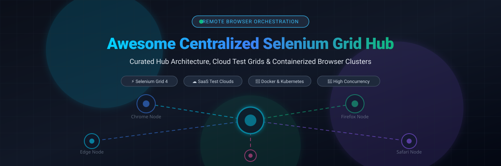

  

# 🌐 Awesome Centralized Selenium Grid Hub ⚡

**Curated Directory of Cloud SaaS Platforms & Open-Source Infrastructure for Centralized Selenium Grid Hubs**  
*Comprehensive guide for Remote WebDriver Routing, Cross-Browser Testing, Parallel Execution & Distributed Containerized Nodes*  
📅 **Last updated: March 2026**

---

## 🧭 Overview & Architecture

A **Centralized Selenium Grid Hub** acts as the single routing endpoint for automated testing frameworks (Selenium WebDriver, Playwright via CDP, Puppeteer, Cypress, Appium). By abstracting browser execution away from local machines and CI runners, a centralized hub orchestrates test sessions across isolated desktop browsers (Chrome, Firefox, Safari, Edge) and real or virtual mobile devices.

Whether you run on-demand cloud infrastructure or manage self-hosted containerized nodes via Docker and Kubernetes, centralized hubs solve key bottlenecks:
- 🚀 **High Concurrency & Parallel Execution**: Reduce test suite execution times from hours to minutes.
- 🌐 **Cross-Browser & Cross-OS Matrix Testing**: Validate web applications against diverse browser versions, OS flavours, and display resolutions.
- 🔒 **Unified Ingress & Secure Tunnels**: Standardize authentication, role-based access control (RBAC), and encrypted local-tunnel connections to private staging environments.
- 📦 **Resource Efficiency & Ephemeral Containers**: Eliminate dirty browser state by dynamically provisioning and destroying isolated browser containers per test session.

---

## 📊 Sector Overview & Market Dynamics

> 💡 **Market Size & Landscape Concentration**: The global automated software testing market is valued at approximately **$24.2 Billion to $28.5 Billion** (with dedicated cloud cross-browser testing platforms accounting for **~$2.8 Billion** and expanding at ~11–14% CAGR). The commercial SaaS sector is **moderately concentrated** around top-tier market leaders—most notably BrowserStack, Sauce Labs, and LambdaTest—which collectively capture majority enterprise market share through global real-device labs and compliance certifications. However, a thriving and fragmented **open-source ecosystem** (powered by Selenium Grid 4, Moon, Docker-Selenium, and headless browser clusters) offers viable self-hosted alternatives for cost-conscious, security-strict engineering teams.

---

## 📑 Table of Contents

- [🧭 Overview & Architecture](#-overview--architecture)
- [📊 Sector Overview & Market Dynamics](#-sector-overview--market-dynamics)
- [☁️ SaaS / Hosted Testing Clouds](#️-saas--hosted-testing-clouds)
- [💻 Open-Source Hub Projects & Infrastructure](#-open-source-hub-projects--infrastructure)
- [🛠️ Architectural Comparison: SaaS vs. Self-Hosted](#️-architectural-comparison-saas-vs-self-hosted)
- [🤝 How to Contribute](#-how-to-contribute)
- [💖 Support & Sponsorship](#-support--sponsorship)
- [📈 Star History](#-star-history)
- [⚠️ Disclaimer](#️-disclaimer)

---

## ☁️ SaaS / Hosted Testing Clouds

The following hosted cloud platforms provide managed Selenium Grid Hub endpoints (`/wd/hub`) with autoscaling infrastructure, pre-configured real/virtual browsers, video logging, and debugging dashboards.

> [!NOTE]
> Platforms are sorted in descending order by estimated company scale (corporate valuation / annual revenue).

| Provider | Scale (Valuation / Revenue) | Starting Price (Automation) | Free Tier / Trial Limits | Key Capabilities & Architecture |
| :--- | :--- | :--- | :--- | :--- |
| **[BrowserStack](https://www.browserstack.com/)** | **~$4.0B Valuation** (~$230M ARR) | **$59/mo** (Chrome Automate, 1 parallel session) / **$99/mo** (Desktop Automate, billed annually) | **Free Trial**: 60–100 automated test minutes; 100 app automation minutes | 3,000+ real desktop browsers & mobile devices. Provides BrowserStack Local encrypted tunnel, parallel execution, and automated session video/log recording. |
| **[Sauce Labs](https://saucelabs.com/)** | **~$613M Valuation** (~$92M ARR) | **$149/mo** (Virtual Device Cloud, billed annually) / Live testing from $39/mo | **28-Day Free Trial**: 60 total automated & live test minutes, up to 3 parallel VMs, 50 AI queries | Enterprise-grade grid supporting Selenium, Playwright (CDP relay), Cypress, and real devices across US and EU data centers. Includes Sauce Connect tunnel and Backtrace error monitoring. |
| **[LambdaTest](https://www.lambdatest.com/)** | **~$400M Valuation** (~$21M+ Revenue) | **$79/mo** (Web Automation, 1 parallel test, billed annually) | **Free Forever Plan**: 100 lifetime automation minutes, 1 concurrent session, limited browser access (plus 6-min/session live test limits) | High-speed cloud Selenium Grid and HyperExecute smart test orchestration with 3,000+ browser combinations, Jenkins integration, and LambdaTest Tunnel for local web assets. |
| **[TestingBot](https://testingbot.com/)** | **~$1M–$10M Small Enterprise** (~$150K ARR) | **$50/mo** (Automated Testing, 1 parallel test, 1,000 automated mins/mo) | **14-Day Free Trial**: 60 total minutes of testing, capped at 5 minutes per continuous session (no credit card required) | Scalable Selenium Grid with 6,100+ browser/OS/device combinations. Simple migration via `https://hub.testingbot.com/wd/hub`, video recording, live screencasts, and REST APIs. |
| **[Moon Cloud](https://aerokube.com/moon/)** *(Aerokube)* | **Micro-Enterprise** (<€1M Revenue) | **$5/mo** per parallel session | **Free Tier**: Up to 3 concurrent parallel browser sessions with basic browser pools | Cloud-managed Kubernetes browser orchestration cluster supporting Selenium, Playwright, Puppeteer, and Cypress with per-second billing economics. |
| **[Gridlastic](https://www.gridlastic.com/)** | **Micro-Enterprise** (Privately bootstrapped) | **$795/mo** (Professional Plan, up to 25 parallel nodes) | **Free Account Plan**: 5 free grid starts, up to 2 parallel nodes, maximum 2 hours run-time per grid start | Dedicated auto-scaling Selenium Grid infrastructure running on AWS with spot instance integration, 24/7 standalone hub, and encrypted Gridlastic Connect tunnels. |

---

## 💻 Open-Source Hub Projects & Infrastructure

Self-hosted and Kubernetes-native Selenium Grid hubs offer complete data privacy, zero vendor lock-in, and predictable infrastructure costs.

> [!TIP]
> Repositories are ranked in descending order by GitHub star count. Each star badge links directly to that repository's stargazers page.

| Project & Repo | Stars | Architecture & Runtime | Description & Primary Use Case |
| :--- | :---: | :--- | :--- |
| **[SeleniumHQ / selenium](https://github.com/SeleniumHQ/selenium)** |  | Java / Distributed Grid | **The official W3C WebDriver reference implementation**. Selenium Grid 4 features a fully modular hub-and-node architecture (Router, Distributor, Session Map, Event Bus, Session Queue, Node). Includes Relay feature to seamlessly proxy Appium and cloud mobile drivers. |
| **[Appium / appium](https://github.com/appium/appium)** |  | Node.js / Mobile Protocol | Open-source ecosystem for cross-platform mobile automation. Integrates natively with Selenium Grid 4 through the Grid Relay node, enabling unified web and mobile automation routing under one central hub. |
| **[Browserless / browserless](https://github.com/browserless/browserless)** |  | Node.js / Docker / Puppeteer / Playwright | High-performance, headless browser orchestration cluster. Acts as a drop-in remote proxy and centralized hub for Chrome, WebDriver, Playwright, and Puppeteer sessions with live session debugger, queue management, and resource concurrency controls. |
| **[SeleniumHQ / docker-selenium](https://github.com/SeleniumHQ/docker-selenium)** |  | Docker / Compose / Helm | Official containerized Docker images and Docker-Compose/Helm deployment definitions for Selenium Grid 4 standalone, hub, and browser nodes (Chrome, Firefox, Edge) with integrated noVNC live viewing and video recording sidecars. |
| **[DeviceFarmer / stf](https://github.com/devicefarmer/stf)** |  | Node.js / RethinkDB | Smartphone Test Farm (STF). Active community continuation of OpenSTF for controlling and managing Android device hardware pools from a centralized browser console, REST API, and remote ADB connector. |
| **[Aerokube / selenoid](https://github.com/aerokube/selenoid)** |  | Go / Docker / Ephemeral | Pioneering Go-based lightweight Selenium hub that spawns browsers inside ephemeral Docker containers per session. *(Archived in Dec 2024; production teams migrate to WebSummoner or Moon).* |
| **[Zalando / zalenium](https://github.com/zalando/zalenium)** |  | Docker / Kubernetes | Flexible and auto-scalable containerized Selenium Grid with video recording, live preview, and on-demand cloud scaling fallback. *(Archived legacy solution; retained for reference).* |
| **[elgalu / docker-selenium](https://github.com/elgalu/docker-selenium)** |  | Docker / Bash | Popular all-in-one standalone Selenium Grid Docker solution with Xvfb, VNC, video recording, and audio recording capabilities. |
| **[Aerokube / ggr](https://github.com/aerokube/ggr)** |  | Go / Reverse Proxy | Go Grid Router: Lightweight reverse proxy that routes incoming Selenium WebDriver traffic across multiple independent Selenoid or Selenium Grid clusters according to client XML quotas. |
| **[Aerokube / moon](https://github.com/aerokube/moon)** |  | Go / Kubernetes Native | Enterprise-ready Kubernetes browser automation platform. Schedules dynamic browser pods for Selenium, Playwright, and Cypress on demand with low latency (~3s cold start) and minimal idle consumption. |
| **[Aerokube / cm](https://github.com/aerokube/cm)** |  | Go / CLI Utility | Configuration Manager for Selenoid and Moon. Automated CLI tool to download, configure, and initialize browser containers, drivers, and license keys with a single command. |
| **[WebSummoner / websummoner](https://github.com/WebSummoner/websummoner)** |  | Go / Ephemeral Containers | Modern, actively maintained Go replacement for archived Selenoid. Spawns isolated ephemeral browser containers per session with video recording, live screen viewing, and backward-compatible `selenoid:options`. |

---

## 🛠️ Architectural Comparison: SaaS vs. Self-Hosted

| Feature Dimension | Cloud SaaS (BrowserStack, Sauce Labs, LambdaTest) | Self-Hosted Open-Source (Grid 4, Moon, Docker-Selenium) |
| :--- | :--- | :--- |
| **Deployment Effort** | 🟢 Zero setup: Instant connection via authentication URL | 🟡 Medium to High: Requires Docker Compose or Kubernetes cluster |
| **Infrastructure Maintenance** | 🟢 Fully managed OS, patches, browser updates, and real devices | 🔴 Team is responsible for VM scaling, browser image builds, and memory limits |
| **Data Privacy & Security** | 🟡 Test traffic leaves internal VPC (requires local tunnel client) | 🟢 Maximum security: Runs entirely air-gapped within internal VPC/network |
| **Cost Scaling Model** | 🔴 Expensive per parallel session / user subscription | 🟢 Fixed infrastructure cost (cloud VM / compute bill only) |
| **Real Device Access** | 🟢 Immediate access to thousands of physical iOS and Android phones | 🔴 Complex physical USB hubs (STF) or emulators required |

---

## 🤝 How to Contribute

Contributions are welcome to keep this directory up-to-date and comprehensive! 🚀

1. 🍴 **Fork the repository** on GitHub.
2. 🌿 **Create a new branch** for your updates (`git checkout -b add-grid-tool`).
3. 📝 **Edit `README.md`** following the established tabular format and guidelines:
   - For SaaS tools: include exact starting pricing and exact free tier/trial limits.
   - For Open-Source tools: include official repo, star badge with white social style, and architectural summary.
4. 🚀 **Submit a Pull Request** with a concise summary of the changes.

---

## 💖 Support & Sponsorship

Thank you so much for taking the time to explore and use this project! Maintaining curated developer resources, benchmarks, and architectural documentation takes continuous effort. If you find this repository valuable for your test automation work, CI/CD pipelines, or team infrastructure, here is how you can show your support:

- ⭐ **Star this repository** on GitHub to help others discover it.
- 🍴 **Fork the repo** and contribute additions, corrections, or tools.
- 📢 **Share it** with fellow QA engineers, SDETs, and DevOps communities on LinkedIn, X/Twitter, or Reddit.
- ☕ **Buy me a coffee / Sponsor the project**: Support ongoing maintenance directly via the [GitHub Sponsors Dashboard](https://github.com/sponsors/ishandutta2007).

&nbsp;&nbsp;

---

## 📈 Star History

---

## ⚠️ Disclaimer

- This list is a **community-curated index** compiled for informational and educational purposes only.
- Centralized Selenium Grids allow arbitrary execution of browser commands. Ensure self-hosted hubs implement authentication (basic auth/tokens), strict VPC isolation, and automatic session cleanup timeouts to protect against resource exhaustion or malicious activity.
- Archived projects (e.g., Selenoid, Zalenium) are documented for migration planning and should not be deployed in new production setups.

---

**Built with ❤️ for QA Engineers, SDETs, and Infrastructure Architects building resilient test automation pipelines.**

